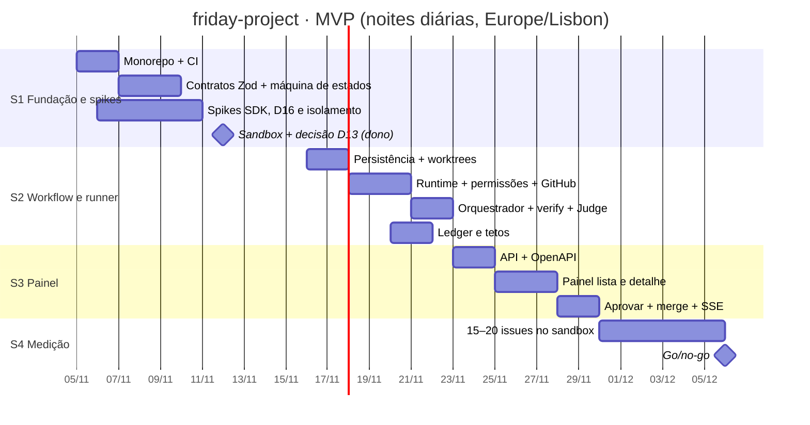

# Cronograma

O MVP de 4 semanas (de `planejamento/13-segunda-opiniao.md` §8), com o painel e o workflow no escopo. As noites trabalham todos os dias. O dono gasta ~1 h por dia. O go/no-go do Friday completo (M1+ de `planejamento/08`) é em **2026-12-06**.

## Capacidade (estimativa, ajustar com a semana 1)
- Teto por noite: 5 refinamentos e 3 implementações. Na prática, contar **~2 merges por noite**: algumas issues param em gate, outras falham.
- 7 noites por semana ⇒ **~12–14 issues por semana**. O gargalo é a sua hora diária nos gates, não a máquina.
- Itens com gate (segurança, tela, teto) param para você: o cronograma conta **1 dia de espera** para cada um.

## Milestones
| Milestone | Período | Entrega | Issues |
|---|---|---|---|
| **S1 · Fundação e spikes** | 05/11 → 15/11 | monorepo + CI, contratos Zod, máquina de estados, 3 spikes, linha de base, D13 decidido | #2–#13 (6 do dono) |
| **S2 · Workflow e runner** | 16/11 → 22/11 | persistência, worktrees, runtime do agente, política de permissões, GitHub, orquestrador, verify, Judge, ledger e tetos | #14–#21 |
| **S3 · Painel** | 23/11 → 29/11 | API Fastify + OpenAPI, painel Blazor (lista e detalhe), aprovar/rejeitar preso ao SHA + merge, SSE | #22–#25 |
| **S4 · Medição e decisão** | 30/11 → 06/12 | 15–20 issues reais no sandbox; métricas; go/no-go | #26–#27 |

## Linha do tempo

## Marcos de decisão do dono
| Data | Decisão | Base |
|---|---|---|
| até 12/11 | **D13**: Blazor WASM ou React no painel | #5 |
| até 14/11 | **D16**: usar o `agile@canary` pelo SDK? | spike #10 |
| 15/11 | Ajustar os tetos da noite | relatórios da semana 1 |
| 06/12 | **Go/no-go** do Friday completo | relatório de métricas (S4) |

## Critérios do go/no-go (de `13` §8; ajustar antes de 30/11)
- ≥ 60% dos PRs aceitos com no máximo 1 correção pequena.
- O seu tempo por issue cai ≥ 50% em relação à linha de base.
- Custo por issue abaixo do teto que você definir até 30/11.
- O Judge pega ≥ 70% dos defeitos plantados.

## Depois do MVP (se for go)
M1 restante, M2 e M3 de `planejamento/08` §5. A estimativa original é de 35–63 dias de esforço para M0–M2, revista com a velocidade medida no MVP. O Friday passa a rodar as próprias noites (dogfooding) quando o loop do M1 estiver estável.

## Siglas
- **API:** Application Programming Interface.
- **CI:** Continuous Integration.
- **MVP:** Minimum Viable Product, produto mínimo viável.
- **PR:** Pull Request.
- **SDK:** Software Development Kit.
- **SHA:** Secure Hash Algorithm; aqui, o identificador do commit.
- **SSE:** Server-Sent Events, envio de eventos do servidor ao navegador.
- **WASM:** WebAssembly.
