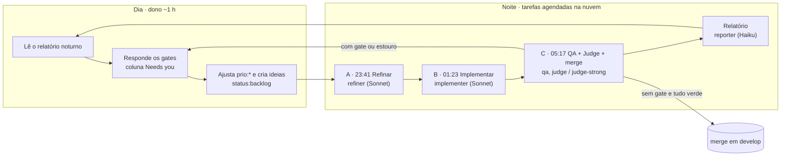
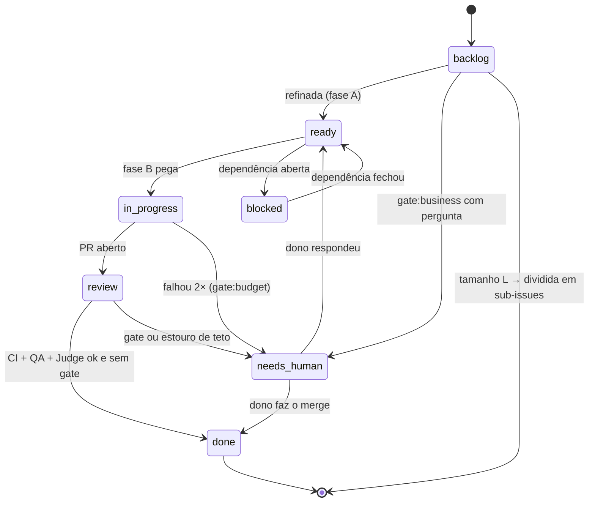
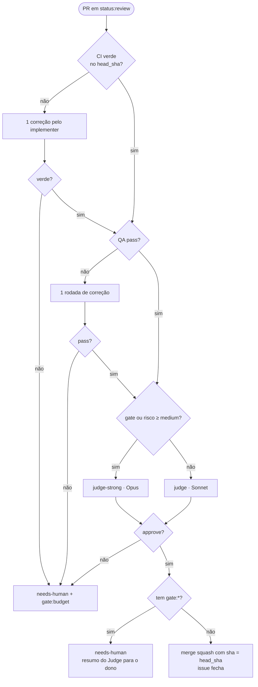
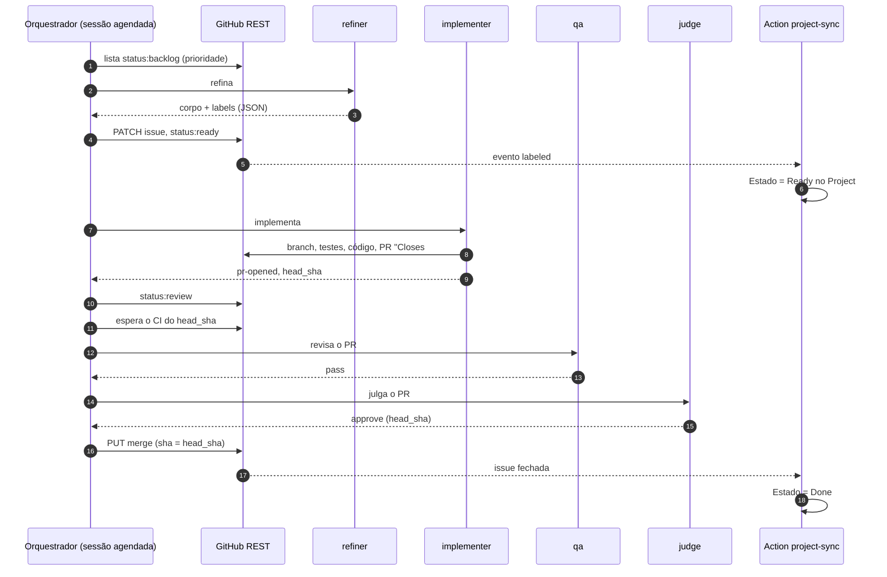
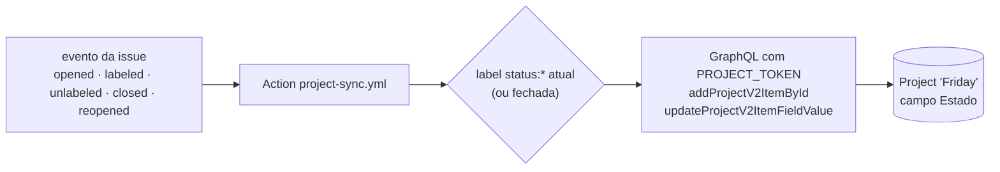

# Diagramas do fluxo

O GitHub renderiza os diagramas Mermaid direto nesta página.

## 1. Visão geral: dia do dono e noite dos agentes

## 2. Estados de uma issue (labels `status:*`)

## 3. Decisão de merge na fase C

## 4. Sequência de uma issue numa noite

## 5. Espelho label → GitHub Project

## Siglas
- **CI:** Continuous Integration.
- **PR:** Pull Request.
- **QA:** Quality Assurance.
- **REST:** Representational State Transfer, estilo de API HTTP.
- **SHA:** Secure Hash Algorithm; aqui, o identificador do commit.
