# Diagramas da arquitetura alvo (TypeScript, 2026-11-04, revisados na S8)

Diagramas **mermaid** da fábrica `fhp` na versão TypeScript + Claude Agent SDK (D1 decidida em 2026-11-04). Cada diagrama indica a seção de origem em `08-implementation-roadmap.md` e, quando houver, em `05`, `03`, `04` e `09`. Nomes de pacotes e APIs estão verificados em `08` §3 `[WEB]`; o que não tem fonte é proposta deste roteiro **[DECIDIR]**.

**Revisão S8 (2026-11-04, frente B):** conferidos contra `08` §4 e §10, `05`, `03`, `04` e `09` (relatório em `sessoes/saida/S8b-revisao-alvo.md`). Mudanças: (b) dividido em (b.1) e (b.2), com `verifyRound`, `Merging → Held`, entrada de monitor e catálogo de `heldReason`; (d) mostra a ausência do portão Bearer 401 e separa 403/404; (e) dividido em (e.1) e (e.2); (f) passa a começar depois das guardas de (k); (i) reorganizado em colunas; novos (k.1), (k.2), (l) e (m). Os ids (a) a (j) continuam os mesmos; sub-ids `.1`/`.2` marcam divisões. Toda a sintaxe foi validada com `@mermaid-js/mermaid-cli` (`mmdc`) em 2026-11-04; alvo de legibilidade: 300 a 1600 px de altura a 1228 px de largura.

## (a) Componentes e contêineres
Origem: `08` §4.1. Um único processo Node (`apps/orchestrator`) contém o tick, o executor de agentes (Agent SDK), o servidor MCP `fhp` **em processo** e a API HTTP. O agente (binário do Claude Code iniciado pelo SDK) só enxerga a worktree e as ferramentas `mcp__fhp__*`; credenciais do GitHub ficam no processo do orquestrador. Sem mudança na S8.

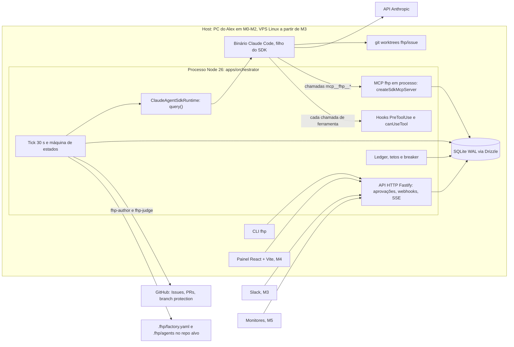

## (b.1) Máquina de estados da issue: caminho principal
Origem: `08` §4.2 e §4.9 (gates G0 a G7); `05` §2.7, §2.9, §3.1; `09` FHP-007, FHP-018, FHP-019, FHP-022 a FHP-024. Nomes do Lode `[VISTO 66:30]` (`03` A.6) mais estados técnicos nossos. `Held` concentra todo "precisa de você", sempre com `heldReason` (catálogo abaixo). **Todos os nós `Held` são o mesmo estado**; aparecem repetidos só para não cruzar setas. Os três laços de volta a `InProgress` (verify, QA e Judge) têm teto 3: `verifyRound` é novo na S8 **[DECIDIR o teto]**, `qaRound` vem de `flow.max_qa_rounds` `[VISTO 65:25]` e `reviewIter` de `iter < 3` `[VISTO 52:00]`. `unclassified` existe só em M1–M2, sem modelo de risco (FHP-025).

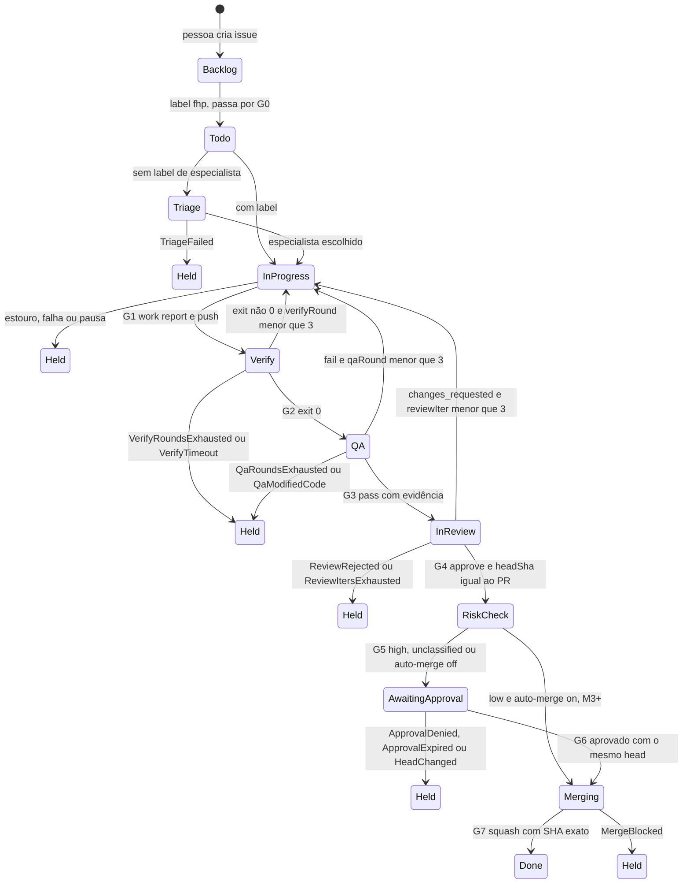

## (b.2) Máquina de estados: Held, Diagnose e pós-merge
Origem: `08` §5 M5 e M6, D11; `03` A.8; `04` §2.3, §2.8; `09` FHP-044 a FHP-047. Monitor cria a issue em `Diagnose` (como `create_state Diagnose` do `sentry-watch` `[VISTO 68:25]`); confiança `medium` fica retida para uma pessoa `[VISTO 70:20, 70:40]`. No pós-merge, nada é revertido sem clique `[VISTO 71:30]`: o incidente diagnosticado espera em `Held{IncidentOpen}` **[DECIDIR o nome]**. O reverter abre o PR de revert, que entra em `Verify` e segue os mesmos gates G2 a G7 de (b.1).

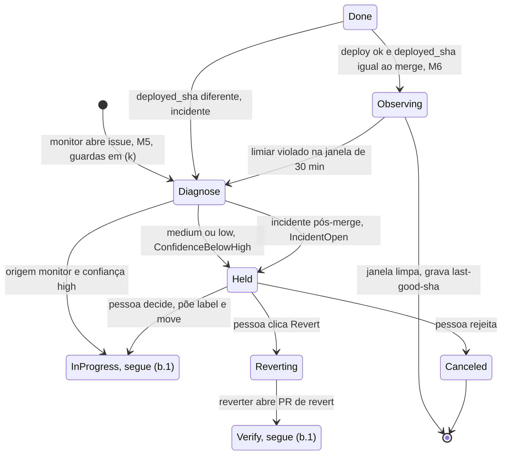

## Catálogo de heldReason
Origem: diagramas (b.1), (b.2), (d), (e.2), (f); `09`. Nomes sem fonte em `08`/`09` estão marcados **[DECIDIR]**.

| heldReason | Onde nasce | Fonte |
|---|---|---|
| `TriageFailed` | Triage com saída inválida | FHP-018 |
| `RunMisconfigured` | `system/init` diverge da ficha | `08` §4.6; FHP-012 |
| `BudgetExceeded`, `TurnsExceeded` | run termina com `error_max_budget_usd` / `error_max_turns` | (f); FHP-028 |
| `RuntimeFailed` | timeout, 5xx ou 429 sem abrir o breaker | (f) |
| `BreakerOpen` | despacho com breaker aberto | (f); FHP-029 |
| `BudgetExhausted` | teto diário | (f); FHP-028 |
| `IssueBudgetExceeded` | teto por issue (`08` §4.10, US$ 5,00) | (f) **[DECIDIR o nome]** |
| `SchemaInvalid` | `structured_output` recusado (422) | (d); literal do Felipe `[VISTO 49:28]` **[DECIDIR o nome]** |
| `VerifyRoundsExhausted` | 3ª falha do verify | (b.1) **[DECIDIR]**, novo na S8 |
| `VerifyTimeout` | verify estoura o tempo | FHP-019 |
| `QaRoundsExhausted` | QA reprovado na 3ª rodada | FHP-007 |
| `QaModifiedCode` | QA sujou a worktree ou mudou `HEAD` | FHP-022; `08` §5 M1 |
| `ReviewItersExhausted` | `changes_requested` na 3ª iteração | FHP-007 |
| `ReviewRejected` | Judge devolve `reject` | (b.1) **[DECIDIR o nome]** |
| `ApprovalDenied`, `ApprovalExpired`, `HeadChanged` | gate humano | (e.2); FHP-024 |
| `MergeBlocked` | branch protection recusa o merge | (e.2) |
| `ConfidenceBelowHigh` | diagnose `medium` ou `low` | FHP-044 |
| `IncidentOpen` | incidente pós-merge diagnosticado | (b.2) **[DECIDIR o nome]** |
| `Reconciled` | run órfã na partida (`canceled_by_reconciliation`) | FHP-016 **[DECIDIR o nome]** |
| `PausedByHuman` | botão Pausar do painel | FHP-039 **[DECIDIR o nome]** |
| `SpecialistWithoutAgent` | triagem escolhe especialista sem ficha | D84; #318 |

## (c) Sequência de uma execução completa
Origem: `08` §4.6–4.9. Uma run de especialista seguida de verify, QA e Judge, até o gate humano. Os agentes nunca falam com o GitHub: as ferramentas `fhp` executam dentro do orquestrador, que usa as identidades de bot. Sem mudança na S8.

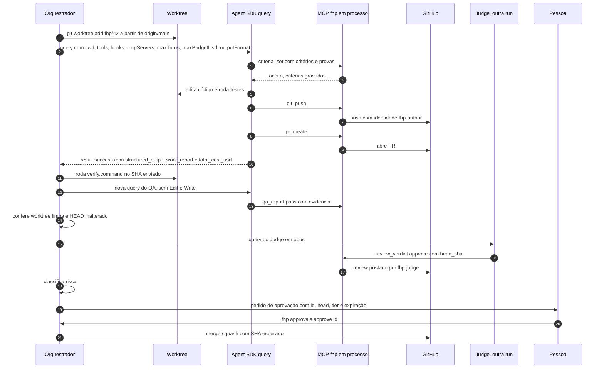

## (d) Validação do contrato
Origem: `08` §4.7–4.8; `05` §2.5–2.6; `09` FHP-006, FHP-014. Duas camadas: o SDK valida a forma (JSON Schema draft-07 gerado do Zod) e o validador da fábrica aplica o schema Zod completo e as 7 regras do Felipe `[VISTO 49:28]`. Ordem dos portões igual à da FHP-014: 403, 404, 409, 422, 200. **Portão 1 (Bearer, 401) não existe nas ferramentas `fhp`: decisão nossa** (`08` §4.8). O que substitui a autenticação: o handler é criado por run (closure com `runId` e papel) e só existe dentro do processo; `allowedTools` e `strictMcpConfig: true` limitam a run às ferramentas `mcp__fhp__*` da ficha; o agente não recebe token algum. O 401 continua nos endpoints HTTP externos, ver (k.1) e (k.2). Recusa nunca dispara retry cego; os laços de volta ao especialista estão em (b.1).

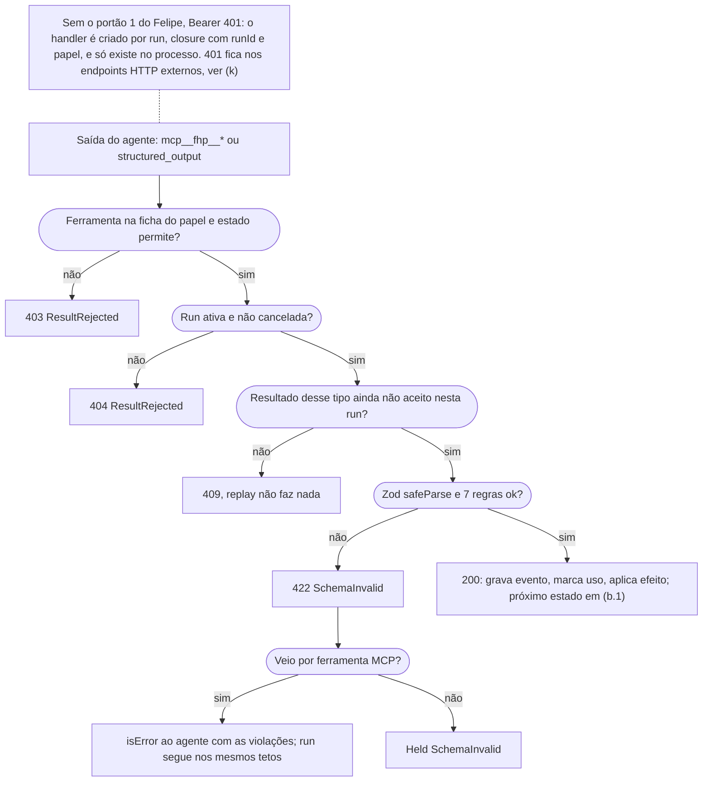

## (e.1) Classificação de risco antes do merge
Origem: `08` §4.9 (G4, G5) e D6; `05` §3.2; `09` FHP-025, FHP-031, FHP-032. Sem regra casando, o modelo lê o diff (M3+); em M1–M2 não há modelo e o resultado é `unclassified`, que vai ao gate humano.

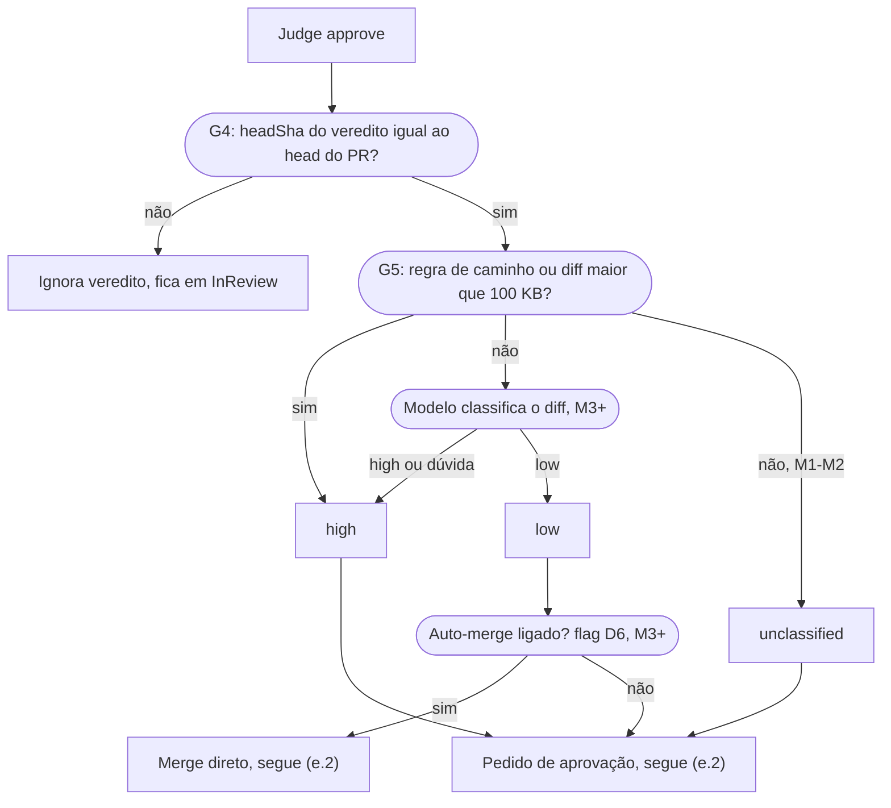

## (e.2) Aprovação ligada ao commit e merge
Origem: `08` §4.9 (G6, G7) e §10; `05` §3.3; `09` FHP-024. A aprovação grava o `headSha`; qualquer push depois dela invalida o pedido, e o GitHub reforça com "dismiss stale approvals" `[WEB]`. Expiração de 30 min como no Lode `[VISTO 68:45, INFERIDO o prazo]`.

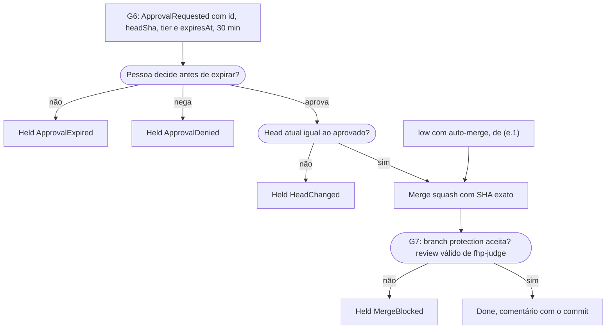

## (f) Orçamento e breaker
Origem: `08` §4.10; `05` §2.3; `09` FHP-027 a FHP-029. Começa depois das guardas de despacho de (k.2) (interruptor e trava da issue). `maxBudgetUsd` do SDK é estimativa do cliente `[WEB]`; o ledger da fábrica é o controle final e conta custo desconhecido como o teto da run.

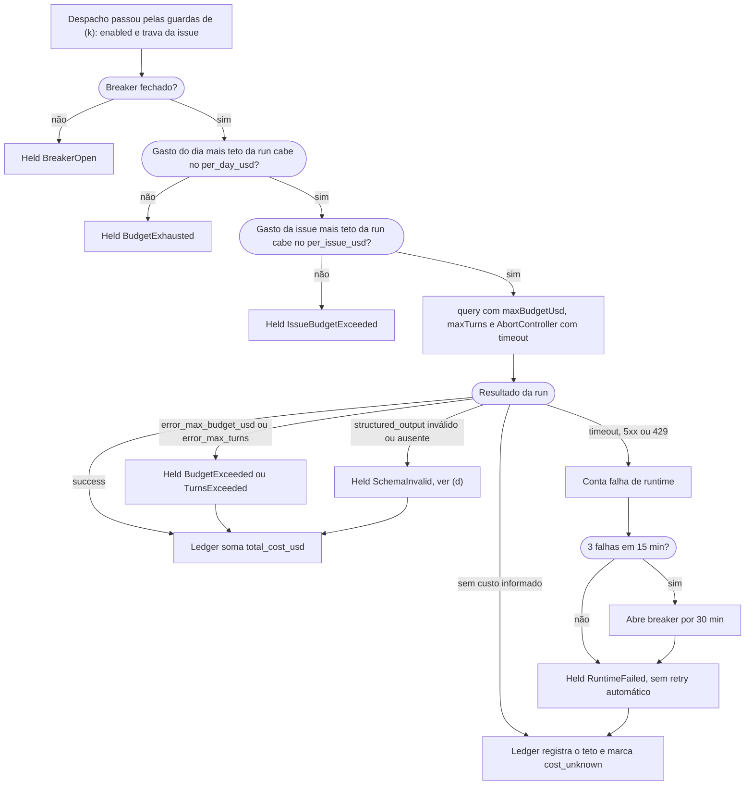

## (g) Modelo de dados
Origem: `08` §4.3–4.4. `events` é append-only; `issues` é projeção reconstruível. Só o hash de tokens de webhook é guardado. S8: `verifyRound` em `ISSUES`. A trava da issue de (k.2) pode ser um índice único parcial em `RUNS(issueId)` para `status` ativo **[DECIDIR]**.

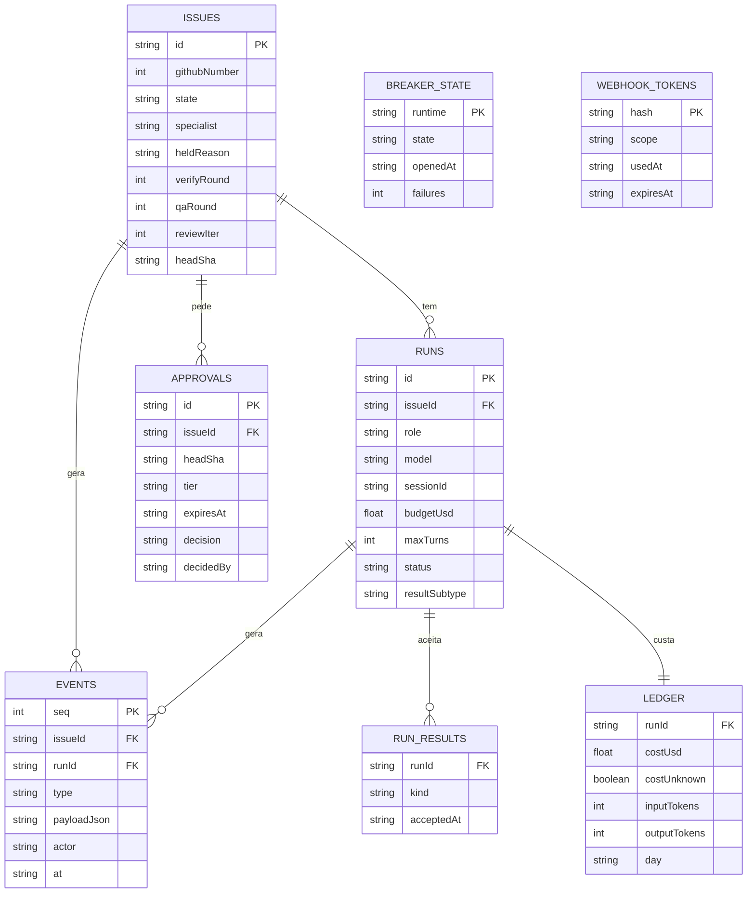

## (h) Implantação local e VPS
Origem: `08` §4.11 e D3. M0–M2 no Windows do Alex; a partir de M3 numa VPS Linux com contêiner por run. O isolamento por contêiner via `spawnClaudeCodeProcess` é **[INFERIDO]** e será confirmado na FHP-034. Sem mudança na S8.

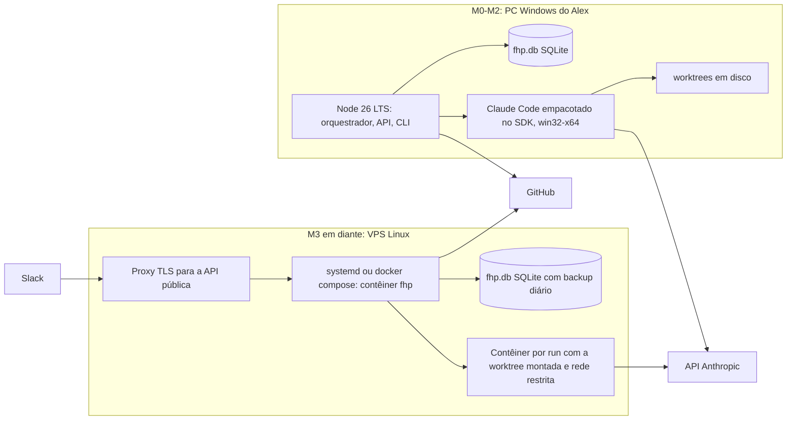

## (i) Marcos
Origem: `08` §5. Dias de trabalho recalculados para TypeScript (curva de aprendizado incluída). Dependências entre colunas (o mermaid liga as setas à borda do grupo): M2 → M3 e M2 → M5; M4 → M7 e M6 → M7.

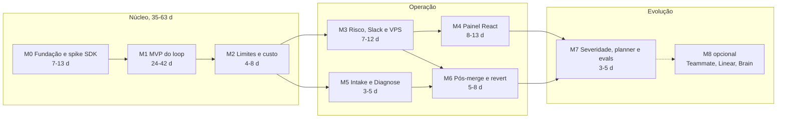

## (j) Laço pós-merge: incidente, Diagnose e revert por clique
Origem: `08` §5 M6 e D11; `09` FHP-045 a FHP-047. Estilo Lode `[VISTO 71:30]`: nada é revertido sem clique de pessoa; o PR de revert passa pelos mesmos gates. Estados em (b.2).

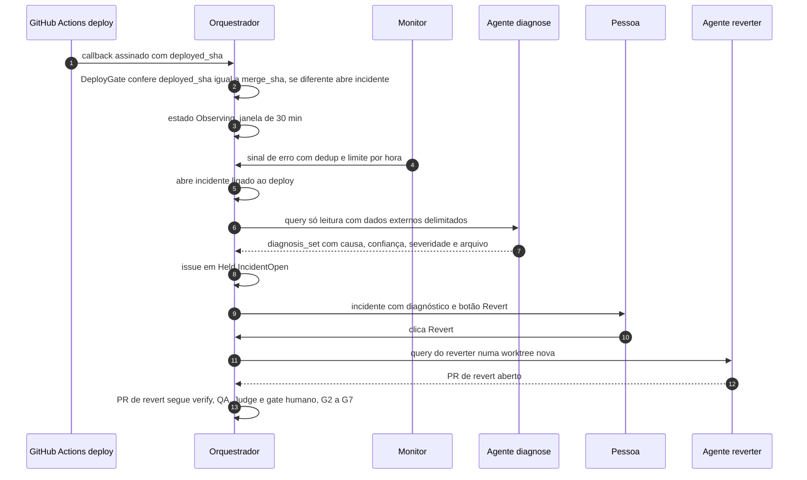

## (k.1) Guardas de entrada: webhook de monitor
Origem: `08` §4.9 (G0) e §5 M5; `05` §2.2 (6 guardas do Felipe `[VISTO 43:20]`, mesma ordem, "da mais barata para a mais cara"); `09` FHP-017, FHP-042, FHP-043. Adaptações nossas: a guarda 1 vira HMAC + janela de tempo (FHP-017) e o Jev vira um classificador `haiku` com `enum noise|signal` (FHP-043), com falha aberta como no Felipe. Novo na S8.

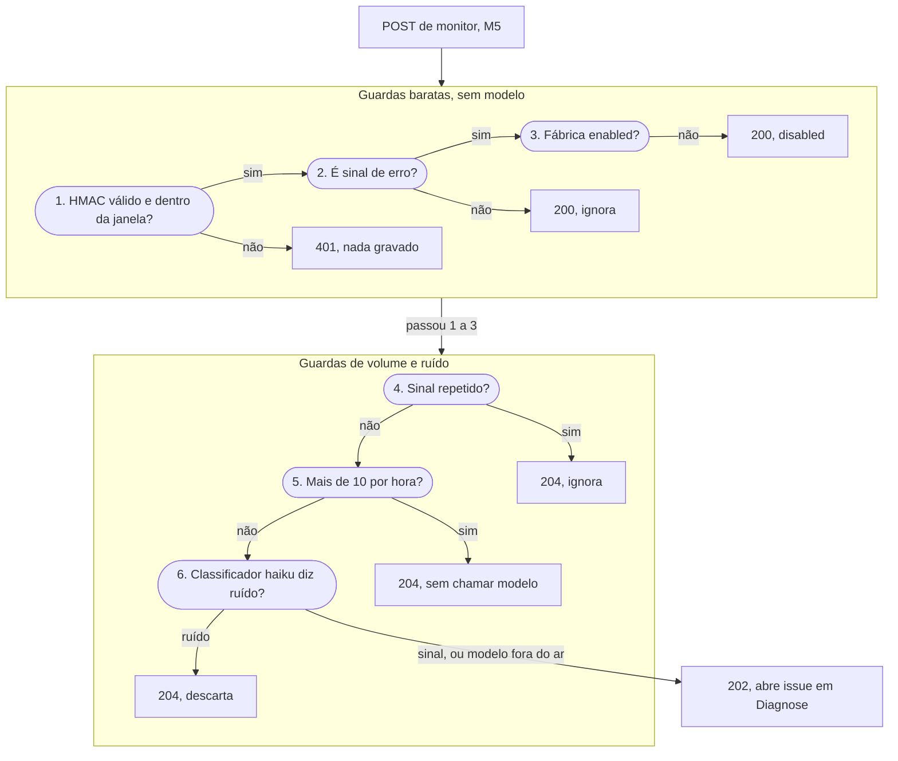

## (k.2) Guardas de despacho e trava da issue
Origem: `05` §2.1 (interruptor, "trava da issue · uma só", 202 / 409 `[VISTO 42:15]`); `08` §4.4, §4.9 (G0); `09` FHP-016, FHP-029, FHP-045. A porta manual equivale à porta 2 do Felipe (`POST /executions`); não existe em `08` e fica **[DECIDIR]**. O callback de deploy usa `webhook_tokens` de uso único (`08` §4.4). Novo na S8.

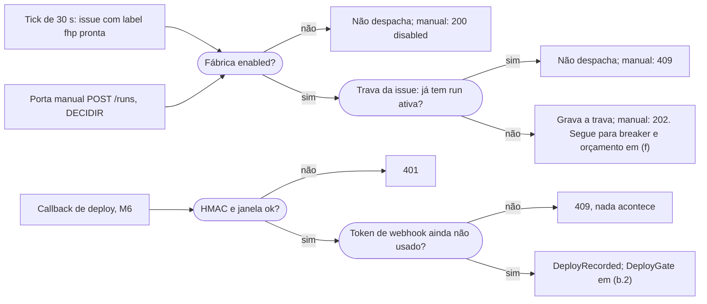

## (l) Agentes e permissões
Origem: `04` §1–3 (fichas e matriz do Lode), `08` §4.5, §4.6, §4.10, §10 e D8; `09` FHP-013, FHP-014, FHP-018 a FHP-023, FHP-044, FHP-047. Uma linha por papel: modelo e tetos (US$ / turnos / tempo), ferramentas built-in, ferramentas `mcp__fhp__*` e o efeito que só o orquestrador aplica. Diferenças em relação ao Lode, decididas em `08`: o QA não recebe `Edit`/`Write` (no Lode recebe, `04` §3); o Judge não tem `pr_merge` (no Lode tem; aqui o merge é da fábrica, `08` §4.1). **[DECIDIR]**: `issue_comment` para especialista e Judge (só o QA tem, `08` §4.5); `WebFetch`/`WebSearch` (o Lode concede ao frontend e ao qa `[VISTO 64:30, 66:05]`); modelo e tetos do reverter; planner (M7) fora do diagrama. Novo na S8.

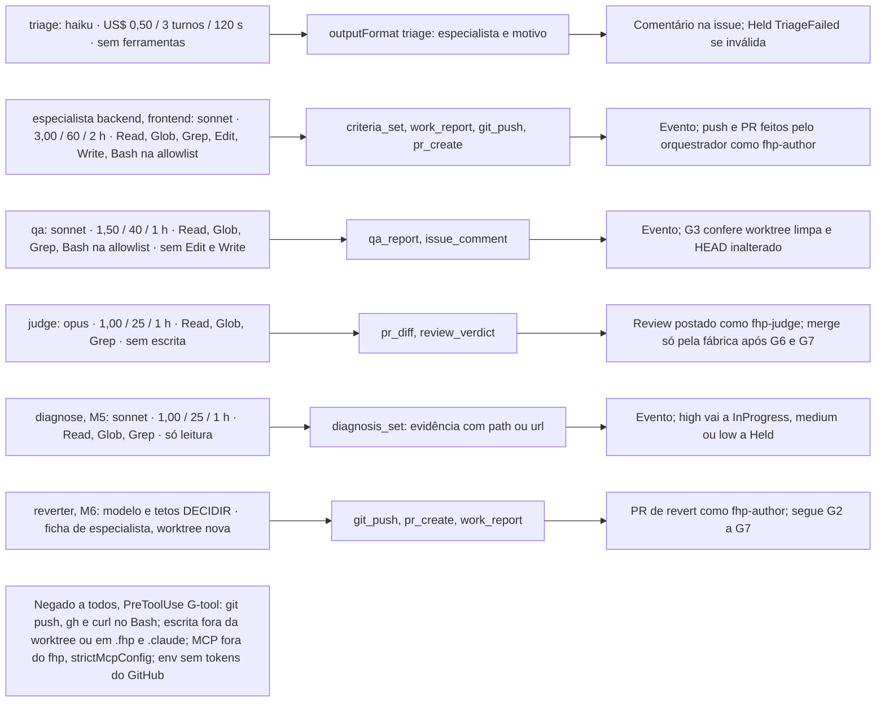

## (m) Painel: telas e ações
Origem: `08` D13 (React 19 + Vite) e §5 M4; `09` FHP-037 a FHP-041; Lode: Board "issues e Needs you", Flow "agentes ao vivo", Workflow "etapas e aprovadores", Quality "custo por PR" `[VISTO 71:30]`, run com Turn n/max, Budget, timeline ao vivo e Pause Agent `[VISTO 70:10]`. Toda ação passa pela API e vira evento (`08` §5 M4); o painel lê por GET e SSE. A projeção `issues` e `events` estão no mesmo banco SQLite; o nó aparece duas vezes só para manter o fluxo da esquerda para a direita. **[DECIDIR]**: rotas de ação em Held e de pausa; telas Library e Telemetry do Lode (sem issue no `09`); autenticação do painel quando a API ficar exposta na VPS. Novo na S8.

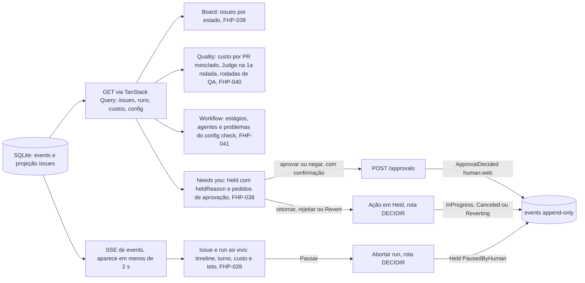

## Siglas
- **API:** interface de programação. **CI:** integração contínua. **CLI:** linha de comando. **ER:** entidade-relacionamento. **HMAC:** assinatura com chave secreta. **HTTP:** protocolo web; **200/202/204/401/403/404/409/422:** ok / aceito / sem conteúdo / não autorizado / proibido / não encontrado / conflito / conteúdo inválido. **JSON:** formato de dados. **MCP:** Model Context Protocol. **PR:** pull request. **QA:** garantia de qualidade. **SDK:** kit de desenvolvimento. **SHA / head_sha / headSha:** identificador do commit / último commit do PR. **SPA:** aplicação de página única. **SSE:** Server-Sent Events. **TLS:** criptografia de transporte. **VPS:** servidor virtual privado. **WAL:** modo de journal do SQLite com leitura concorrente.
- **G0…G7, G-tool:** gates (`08` §4.9). **M0…M8:** marcos (`08` §5). **D3, D6, D8, D11, D13:** decisões (`08` §0). **FHP-nnn:** issues (`09`).
